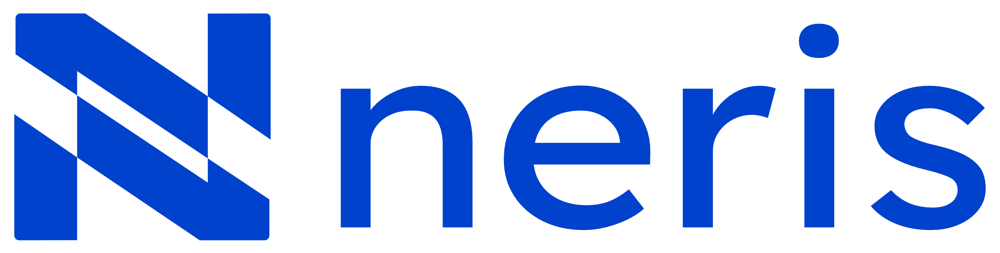

# Neris



A macOS menu-bar app for translating text you have selected in any app — without leaving the app you are typing in.

**Status: v1 feature-complete, distributed through GitHub Releases.** All four shortcuts, the Translate Window's Translate and Improve modes, History, Settings and first-run onboarding are implemented and covered by the test suite. A tag-triggered workflow builds and signs a universal bundle and opens a draft Release; the app updates itself from the menu bar. Builds are signed by the maintainer's certificate rather than notarised by Apple — [ADR-0009](docs/adr/0009-self-signed-distribution-and-in-app-updates.md) records the trade-off and the one Gatekeeper step it costs a first install.

## Shortcuts

| Shortcut | Action |
| --- | --- |
| `⌥⇧D` | **Quick Translate** — popup next to the cursor with the translation |
| `⌥⇧R` | **Replace** the Selection with its translation |
| `⌥⇧S` | **Read Aloud** — speak the Selection in the system voice |
| `⌥⇧E` | Open the **Translate Window** |

The bindings are user-editable in Settings.

## Install

Download the latest `Neris_<version>_universal.dmg` from
[Releases](https://github.com/taitranhuu2302/translator/releases/latest), drag
**Neris** into **Applications**, then remove the quarantine flag once — the
bundle is signed by the maintainer, not notarised by Apple:

```bash
xattr -dr com.apple.quarantine /Applications/Neris.app
```

Open Neris and grant Accessibility once; the grant survives every update.
[docs/install.md](docs/install.md) has the full first-run steps.

## Updates

A Release build checks GitHub at launch and every six hours and downloads a
newer version in the background. It never restarts on its own: when the update
is ready, the menu bar gains **Restart to Update to X.Y.Z…**. Settings →
Updates shows the current version, a **Check now** button and a switch that
turns the automatic check off. A local `scripts/build.sh` bundle has no
updater and can never replace itself.

## How it works

**Direction.** A Language Pair holds one configured Target. A Selection already in the Target language is translated into the other member of the pair; anything else is translated into the Target.

**Translation.** Azure Translator F0 as the primary provider, falling back to keyless MyMemory so the app works before any key is configured. A provider that fails authentication or quota is skipped for the rest of the session, and every answer names the provider that gave it. See [ADR-0003](docs/adr/0003-translation-provider-ladder.md).

**Improve.** The Translate Window's second mode rewrites a sentence: the corrected version and a better version side by side, streamed from Groq.

**History.** Translations and improvements are recorded in a local SQLite database under `~/Library/Application Support/<bundle identifier>/` and searchable from the History sheet. Entries older than 30 days are pruned on launch. Nothing is synced or sent anywhere.

**Keys.** Provider keys live in the login Keychain, one item per provider, and are read when a request is made — a key saved in Settings takes effect without a restart.

**Capture.** The macOS Accessibility API first; a clipboard round trip for apps that expose nothing (browsers, Electron apps, terminals). Every path reports failure rather than silently doing nothing, and secure fields are refused outright. See [ADR-0002](docs/adr/0002-accessibility-first-clipboard-fallback.md).

## Stack

A Rust workspace with a Tauri v2 shell and a React 19 UI on Tailwind CSS v4 and shadcn/ui:

- `core` — the product logic and the port traits, with no platform dependency.
- `platform-macos` — the only crate that touches AppKit, ApplicationServices, AVFoundation or the Keychain.
- `app` — the Tauri shell that builds the ports, owns the engine and hosts the UI.

See [ADR-0001](docs/adr/0001-rust-core-with-tauri-shell.md) for the stack, [ADR-0006](docs/adr/0006-tailwind-and-shadcn-for-ui.md) for the UI foundation, and [ADR-0005](docs/adr/0005-non-activating-panel-popup.md) for the popup.

## Requirements

- macOS 14 or later
- Rust toolchain (stable)
- Node 22+ — build-time only, never a runtime dependency

## Build

Run these from the repository root. `npm install` installs the root tooling and the `ui` workspace through one lockfile; the npm commands cover the UI.

```bash
npm install           # once
npm test              # UI tests
npm run build         # build ui/dist

./scripts/test.sh     # typecheck, UI tests and build, IPC boundary and identity checks, cargo test
./scripts/build.sh    # build the frontend and the app, then sign target/bundle/Neris.app
```

The per-package commands (`npm --prefix ui run test`, `npm --prefix ui run build`) still work for a fast loop on the UI alone.

`scripts/build.sh` packages a real `.app` with `LSUIElement` and signs it with the stable local identity; it refuses to package unsigned, ad-hoc, or with the frontend placeholder still in `ui/dist`. See [ADR-0004](docs/adr/0004-stable-signing-from-first-commit.md).

Both `scripts/build.sh` and the release workflow delegate to `scripts/package.sh`, so the bundle this Mac runs and the bundle a release ships are assembled by the same code. `--universal` builds both Apple architectures and lipos them; `--updater` is what a release adds, and is deliberately absent from a local build.

```bash
./scripts/package.sh --universal            # both architectures, no updater
./scripts/package.sh --universal --updater  # what a release ships
```

A release is a tag on `main`: bump the version with `./scripts/set-version.sh X.Y.Z`, push `vX.Y.Z`, and the workflow verifies the tag, re-runs the suite, builds, signs and opens a draft. The secrets, the update key and the publishing step are in [docs/release.md](docs/release.md). See [ADR-0010](docs/adr/0010-tag-driven-release-from-github.md).

The Windows workflow builds an unsigned, per-user `Neris_<version>_x64-setup.exe` on demand or on a tag, and leaves it as an artifact of that run — it is never attached to a release. The app inside it still does not work on Windows: only the build is done, the port is not ([.scratch/windows-build/spec.md](.scratch/windows-build/spec.md), [.scratch/windows-port/spec.md](.scratch/windows-port/spec.md)).

## Develop

```bash
npm install           # once, at the repository root
npx tauri dev         # vite on :1420 with HMR, the webview talks to the real engine
```

`tauri dev` runs the unsigned `target/debug/translator`, so the Accessibility grant does not apply: Selection capture and the non-activating popup only behave under `scripts/build.sh`. The production build turns on the `custom-protocol` feature, which is what embeds `ui/dist` rather than loading the dev server.

`ui/preview.html` renders every surface and state with mock data: run `npm --prefix ui run dev` and open http://localhost:1420/preview.html. It is not an input of the production build, so no mock data ships inside the app.

## Upgrading from 0.1.0

The app is now Neris and its bundle identifier changed, which macOS keys the Accessibility grant to. On first launch the app copies the previous version's settings, history and stored keys into the new location and leaves the old ones alone; you then re-grant Accessibility once and turn "Start at login" back on once. See [ADR-0007](docs/adr/0007-rename-to-neris.md).

## Project docs

- [GLOSSARY.md](GLOSSARY.md) — the domain language used in code, specs and tickets
- [docs/adr/](docs/adr/) — architecture decisions
- [docs/install.md](docs/install.md) — what a first install downloads and the one Gatekeeper step
- [docs/release.md](docs/release.md) — the maintainer runbook: secrets, the update key, cutting and publishing a release
- [.scratch/translator-v1/spec.md](.scratch/translator-v1/spec.md) — the v1 spec, its tickets and the manual test plan
- [.scratch/architecture-deepening/spec.md](.scratch/architecture-deepening/spec.md) — the consolidation effort: one home per rule
- [.scratch/ui-redesign/spec.md](.scratch/ui-redesign/spec.md) — the design system effort: Tailwind, shadcn and the Neris palette
- [.scratch/release-pipeline/spec.md](.scratch/release-pipeline/spec.md) — CI, tag-driven releases and in-app updates
- [.scratch/windows-build/spec.md](.scratch/windows-build/spec.md) — the Windows build: compile gate, NSIS installer, and the slice of the port that made it possible
- [.scratch/windows-port/spec.md](.scratch/windows-port/spec.md) — the Windows contract: artifact, manifest key, installer and CI job
- [.claude/skills/neris-ui/SKILL.md](.claude/skills/neris-ui/SKILL.md) — the UI conventions a later change has to follow

Each effort keeps one ticket per independently shippable change under `issues/`. Anything that needs a human eye is handed over as a table under `checks/`: the app is built and signed by an agent but never launched by one, so the person runs the bundle and walks the table.

## License

MIT — see [LICENSE](LICENSE).
